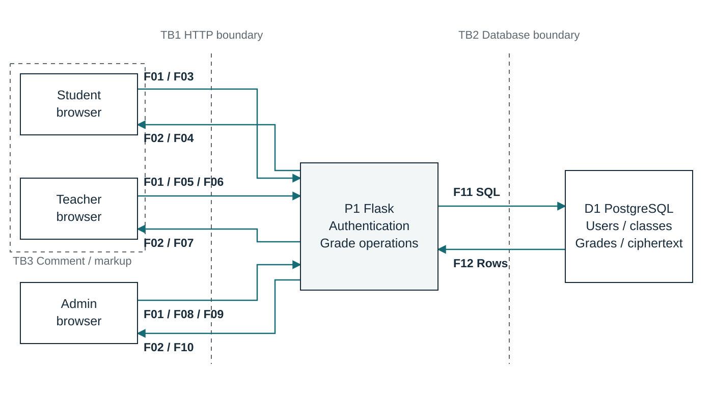
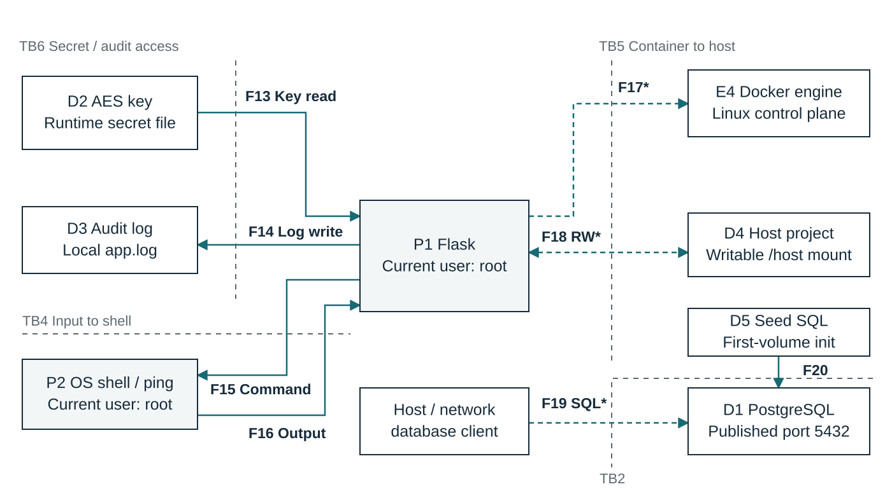

# Project 1: NotesApp threat model and risk analysis

Review date: 2026-10-09. Basis: Current working tree, including the Session 3 AES-GCM comment homework.

## 1. Submission brief

Course requirement: groups of 3-4, 15% of the grade, GitHub hand-in before 20 October, and a three-minute presentation on 20 October. The source does not specify a cutoff time or year. The current course dates are treated as October 2026.

Required deliverables: all trust boundaries on a numbered DFD, at least one threat for each STRIDE letter, likelihood x impact for every threat, and a fix for each of the three highest risks. This project proposes fixes; it does not claim that the deliberately planted flaws have been repaired.

## 2. Scope, assets and assumptions

- Student grades, comment plaintext and student/class associations: confidentiality and integrity.
- Passwords, signed sessions, JWT signing keys and AES keys: confidentiality and authenticity.
- Teacher/admin authority, PostgreSQL administration and Docker engine authority: least privilege.
- Application, database, host project and stored records: availability and recoverability.
- Grade/user change history and audit events: accountability and reconstructable evidence.

- The model covers the supplied local Docker/Flask/PostgreSQL teaching system as of 9 October 2026, including the comment encryption homework. This is a working-tree review, not a claim about an unchanged upstream commit.
- Untrusted people can send requests where the web port is reachable. Ordinary students/teachers are potential malicious insiders. PostgreSQL remote access remains conditional on host firewall/routing; a published port is not proof of internet reachability.
- Key, database and administrator compromise appear as prerequisites where required. No credential attack, SQL payload, shell command injection, Docker escape or traffic flood was executed for this review.
- Normal role policy is: students read their own records; teachers manage/export only classes they own; administrators manage users/classes. The existing UI limits alone do not enforce this policy.
- The optional HTTPS example is inactive. The active compose configuration publishes HTTP and PostgreSQL. Email, external identity providers, payment services and school infrastructure are outside scope.

Runtime observations (read-only): 35 users, 4 classes, 60 notes and 60 encrypted comments; web UID 0; application database role rolsuper=true.

## 3. Numbered data-flow diagrams and trust boundaries

The application and deployment views form one model. Every arrow has an F number. Solid arrows show ordinary application/initialization flows; dashed arrows show conditional direct access or capabilities available to a compromised process.

| Boundary | Crossing | Why it needs a check |
|---|---|---|
| TB1 | Browser / network to Flask | Credentials, cookies, JWTs and all request parameters come from a client outside server control. The current deployment uses HTTP. |
| TB2 | Application or host network to PostgreSQL | Database authentication and SQL separate application input from stored records. The published port also creates a path that bypasses Flask. |
| TB3 | Stored comment text to browser execution | The browser must treat returned comments as data. Disabled Jinja escaping lets stored content cross into executable page markup. |
| TB4 | Admin form input to OS command interpreter | An authenticated host field remains untrusted. shell=True interprets it as shell syntax with the web process privileges. |
| TB5 | Web container to Docker engine and mounted host project | Docker socket access grants control of the Linux Docker engine. The writable /host mount exposes project files, including the original AES key file. On Docker Desktop, Linux engine control does not itself prove Windows kernel administrator access. |
| TB6 | Application to secret and audit storage | Key loading and audit writes cross a storage access boundary. This is a logical protection boundary, not a separate container. Root execution and permissive log/config/backup permissions weaken its enforcement. |

## 4. Flow register

| Flow | Sender -> receiver | Data | Boundaries |
|---|---|---|---|
| F01 | Student, teacher or admin browser -> P1 Flask | POST /login: username and password | TB1 |
| F02 | P1 Flask -> All browser roles | Login response, signed session cookie and dashboard JWT | TB1 |
| F03 | Student browser -> P1 Flask | GET /dashboard or /api/notes/<id>, session or Bearer JWT | TB1 |
| F04 | P1 Flask -> Student browser | Readable grade/comment HTML or JSON | TB1, TB3 |
| F05 | Teacher browser -> P1 Flask | GET /teacher or /export.csv, optional class_id | TB1 |
| F06 | Teacher browser -> P1 Flask | POST /grades: note_id, student_id, class_id, grade, comment | TB1 |
| F07 | P1 Flask -> Teacher browser | All grades/comments in HTML or CSV | TB1, TB3 |
| F08 | Admin browser -> P1 Flask | GET /admin or POST /admin/users: action and user fields | TB1 |
| F09 | Admin browser -> P1 Flask | POST /admin/ping: host field | TB1 |
| F10 | P1 Flask -> Admin browser | User/class listings and ping stdout/stderr | TB1 |
| F11 | P1 Flask / startup migration -> D1 PostgreSQL | SQL SELECT/INSERT/UPDATE/DELETE. Comment writes use AES-GCM ciphertext | TB2 |
| F12 | D1 PostgreSQL -> P1 Flask | Rows: plaintext user/password/grade metadata and encrypted comments | TB2 |
| F13 | D2 AES secret file -> P1 Flask | 32-byte AES key loaded through /run/secrets/comment_encryption_key | TB6 |
| F14 | P1 Flask -> D3 Local audit log | Login, grade-write and ping messages appended to app.log | TB6 |
| F15 | P1 Flask -> P2 OS shell / ping | Constructed ping command containing the submitted host field | TB4 |
| F16 | P2 OS shell / ping -> P1 Flask | stdout, stderr or timeout/error text | TB4 |
| F17 | Compromised P1 process -> E4 Docker engine | Potential engine API requests through mounted docker.sock | TB5 |
| F18 | P1 process -> D4 Mounted host project | Potential reads/writes through .:/host, including .secrets and source | TB5 |
| F19 | Host/network database client -> D1 PostgreSQL | Potential direct PostgreSQL connection through published port 5432 | TB2 |
| F20 | D5 Seed SQL mount / Docker initialization -> D1 PostgreSQL | First-volume initialization SQL, including seed users and plaintext comments before the startup migration | TB2 |

## 5. STRIDE coverage for every flow

Each flow was considered against all six questions. Cells refer to the concrete threat IDs below; a dash means no separate concrete threat in that category was identified in this review. A threat can affect multiple flows, and its score is counted once rather than summed across those flows.

| Flow | S | T | R | I | D | E |
|---|---|---|---|---|---|---|
| F01 | S02 | - | - | I02 | D01 | - |
| F02 | S01, S03 | - | - | I02 | - | - |
| F03 | S01 | - | - | I01 | D01 | - |
| F04 | - | T03 | - | I01, I02 | - | - |
| F05 | - | T01 | - | - | D01 | - |
| F06 | S03 | T01, T02, T03 | R01 | - | - | - |
| F07 | - | T03 | - | I02 | - | - |
| F08 | S03 | T02 | R01 | - | - | - |
| F09 | S03 | T02 | - | - | - | E01 |
| F10 | - | - | - | I02 | - | - |
| F11 | S02 | T01, T04 | - | - | D02 | E02 |
| F12 | S02 | T04 | - | I01, I03 | D02 | - |
| F13 | - | - | - | I04 | D02 | - |
| F14 | - | - | R01 | - | D01 | - |
| F15 | - | - | - | - | - | E01 |
| F16 | - | - | - | - | - | E01 |
| F17 | - | - | - | - | - | E01 |
| F18 | - | - | - | I04 | - | E01 |
| F19 | - | T04 | - | I03 | - | E02 |
| F20 | - | - | - | I03 | - | - |

## 6. Risk method and ranked STRIDE register

Risk = likelihood x impact, with each dimension scored 1-5. These are qualitative judgments based on prerequisites and credible consequences, not measured probabilities or CVSS scores. The course specifies multiplication but not a numeric scale; this scale is our stated analytical choice.

| Score | Likelihood: prerequisites and effort | Impact: maximum credible consequence |
|---|---|---|
| 1 | Exceptional conditions or strong controls | Minor inconvenience, no sensitive data or lasting change |
| 2 | Several difficult prerequisites | Limited, reversible effect on a small set of records |
| 3 | Network position, privileged foothold or another failure required | Service outage, incomplete audit or a limited data incident |
| 4 | Simple with ordinary access or public configuration | Many student records or cross-class integrity/confidentiality loss |
| 5 | Public unauthenticated entry with direct unsafe processing | Administrator, database-wide or Linux Docker engine compromise |

Bands: 1-5 Low, 6-11 Medium, 12-19 High, 20-25 Critical. Order by score, then impact. The 20-point tie puts E01 before S03 because Docker engine/project control extends the affected boundary. Attack chains overlap, so risk scores must not be added into a total.

| ID | STRIDE | Threat | L | I | L x I | Band | Flows | Evidence |
|---|---|---|---:|---:|---:|---|---|---|
| S02 | S | SQL injection at login | 5 | 5 | 25 | Critical | F01, F11, F12 | [web/app.py:155-175](../web/app.py#L155), [docker-compose.yml:4-7](../docker-compose.yml#L4), [web/app.py:50-56](../web/app.py#L50) |
| E01 | E | Admin shell injection reaches Docker engine control | 4 | 5 | 20 | Critical | F09, F15, F16, F17, F18 | [web/app.py:356-373](../web/app.py#L356), [web/Dockerfile:24](../web/Dockerfile#L24), [docker-compose.yml:36-40](../docker-compose.yml#L36) |
| S03 | S | Public Flask session signing key | 4 | 5 | 20 | Critical | F02, F06, F08, F09 | [docker-compose.yml:27-28](../docker-compose.yml#L27), [web/app.py:31-35](../web/app.py#L31), [web/app.py:133-138](../web/app.py#L133), [web/app.py:341-367](../web/app.py#L341), [web/app.py:394-411](../web/app.py#L394) |
| S01 | S | Unsigned or weakly signed JWT identity | 5 | 4 | 20 | Critical | F02, F03 | [web/app.py:90-116](../web/app.py#L90), [web/app.py:119-129](../web/app.py#L119), [web/app.py:216-238](../web/app.py#L216) |
| I01 | I | Any student reads another student's decrypted note | 4 | 4 | 16 | High | F03, F04, F12 | [web/app.py:216-238](../web/app.py#L216) |
| T01 | T | Teacher changes another teacher's records | 4 | 4 | 16 | High | F05, F06, F11 | [web/app.py:241-261](../web/app.py#L241), [web/app.py:264-303](../web/app.py#L264), [web/app.py:306-338](../web/app.py#L306) |
| T03 | T | Stored comment executes in the browser | 4 | 4 | 16 | High | F06, F04, F07 | [web/templates/dashboard.html:14-15](../web/templates/dashboard.html#L14), [web/templates/teacher.html:41-47](../web/templates/teacher.html#L41), [web/templates/dashboard.html:33-39](../web/templates/dashboard.html#L33), [web/app.py:59-61](../web/app.py#L59) |
| E02 | E | Application database role has superuser privileges | 3 | 5 | 15 | High | F11, F19 | [docker-compose.yml:4-7](../docker-compose.yml#L4), [web/app.py:26-29](../web/app.py#L26), [web/app.py:50-55](../web/app.py#L50) |
| I03 | I | Direct database access reveals plaintext credentials | 3 | 5 | 15 | High | F12, F19, F20 | [docker-compose.yml:4-12](../docker-compose.yml#L4), [db/init.sql:6-12](../db/init.sql#L6), [web/Dockerfile:17-22](../web/Dockerfile#L17) |
| I04 | I | Web process compromise exposes the AES key | 3 | 5 | 15 | High | F13, F18 | [docker-compose.yml:29-40](../docker-compose.yml#L29), [docker-compose.yml:45-47](../docker-compose.yml#L45), [web/comment_crypto.py:28-42](../web/comment_crypto.py#L28), [web/Dockerfile:24](../web/Dockerfile#L24) |
| I02 | I | Plain HTTP exposes credentials and responses | 3 | 4 | 12 | High | F01, F02, F04, F07, F10 | [docker-compose.yml:31-32](../docker-compose.yml#L31), [web/app.py:424-426](../web/app.py#L424), [docker-compose.https.yml.example:1-7](../docker-compose.https.yml.example#L1) |
| T02 | T | State-changing requests lack CSRF verification | 3 | 4 | 12 | High | F06, F08, F09 | [web/app.py:264-273](../web/app.py#L264), [web/app.py:356-367](../web/app.py#L356), [web/app.py:394-409](../web/app.py#L394), [web/templates/teacher.html:16-33](../web/templates/teacher.html#L16), [web/templates/admin.html:14-35](../web/templates/admin.html#L14) |
| T04 | T | Database edits bypass the comment's limited AAD scope | 3 | 4 | 12 | High | F11, F12, F19 | [web/comment_crypto.py:44-62](../web/comment_crypto.py#L44), [db/init.sql:26-32](../db/init.sql#L26) |
| D01 | D | Unbounded requests and logs exhaust resources | 4 | 3 | 12 | High | F01, F03, F05, F14 | [web/app.py:40-55](../web/app.py#L40), [web/app.py:155-188](../web/app.py#L155), [web/app.py:306-338](../web/app.py#L306), [docker-compose.yml:17-40](../docker-compose.yml#L17), [web/app.py:426](../web/app.py#L426) |
| R01 | R | Grade changes have insufficient audit evidence | 4 | 3 | 12 | High | F06, F08, F14 | [web/app.py:40-46](../web/app.py#L40), [web/app.py:302-303](../web/app.py#L302), [web/app.py:394-411](../web/app.py#L394), [web/Dockerfile:15-22](../web/Dockerfile#L15) |
| D02 | D | Unreadable encrypted comment blocks service startup | 3 | 3 | 9 | Medium | F11, F12, F13 | [web/migrate_comments.py:13-45](../web/migrate_comments.py#L13), [web/Dockerfile:28](../web/Dockerfile#L28), [web/comment_crypto.py:61-78](../web/comment_crypto.py#L61) |

## 7. Threat scenarios, scoring reasons and fixes

### S02: SQL injection at login (25/25)

**Scenario and consequence:** Untrusted login strings become SQL syntax. A changed query can return another identity or operate with the application database role.

**Prerequisite:** Unauthenticated access to POST /login.

**Likelihood 5/5:** The public login directly concatenates both inputs without binding parameters.

**Impact 5/5:** A returned admin identity enables privileged routes. The runtime application database role is also a superuser, increasing database-wide damage.

**Flows / boundaries:** F01, F11, F12 / TB1, TB2.

**Evidence:** [web/app.py:155-175](../web/app.py#L155), [docker-compose.yml:4-7](../docker-compose.yml#L4), [web/app.py:50-56](../web/app.py#L50).

**Proposed fix:** Bind username with a parameterized lookup, verify a password hash separately, suppress raw query errors, and give the application a limited non-superuser database role.

### E01: Admin shell injection reaches Docker engine control (20/25)

**Scenario and consequence:** An admin-capable caller inserts shell syntax in host. The command runs as root, and the process can reach the Docker socket and writable host project. SQL login bypass or the public session key can provide the admin session first.

**Prerequisite:** An admin session, obtained legitimately or through S02/S03. Docker daemon/socket availability as configured.

**Likelihood 4/5:** The shell and root configuration are explicit and the public session key makes the admin prerequisite reachable without a private secret.

**Impact 5/5:** Code execution can control the Linux Docker engine and alter mounted project data or retrieve keys. Native Windows kernel takeover was not tested or claimed.

**Flows / boundaries:** F09, F15, F16, F17, F18 / TB1, TB4, TB5.

**Evidence:** [web/app.py:356-373](../web/app.py#L356), [web/Dockerfile:24](../web/Dockerfile#L24), [docker-compose.yml:36-40](../docker-compose.yml#L36).

**Proposed fix:** Remove the ping feature or strictly validate an IP and run an argument list with shell=False. Remove socket and broad host mounts, run non-root, drop capabilities and restrict writable paths.

### S03: Public Flask session signing key (20/25)

**Scenario and consequence:** A person who knows the public development signing key can construct a session asserting an admin or teacher role. Privileged routes trust those cookie fields.

**Prerequisite:** Access to the public repository/configuration and HTTP requests.

**Likelihood 4/5:** The signing key is committed and is also the application fallback, so no key guessing is required.

**Impact 5/5:** A forged admin session can manage users and reach the unsafe command runner. This is a chained impact, not a claim that alg:none JWTs directly log into admin pages.

**Flows / boundaries:** F02, F06, F08, F09 / TB1.

**Evidence:** [docker-compose.yml:27-28](../docker-compose.yml#L27), [web/app.py:31-35](../web/app.py#L31), [web/app.py:133-138](../web/app.py#L133), [web/app.py:341-367](../web/app.py#L341), [web/app.py:394-411](../web/app.py#L394).

**Proposed fix:** Load a new random session key from separate secret storage, fail startup if absent, invalidate old sessions, and re-read current user/role from the database before privileged actions.

### S01: Unsigned or weakly signed JWT identity (20/25)

**Scenario and consequence:** A caller supplies an unsigned JWT identity. The API accepts alg:none and only checks that an identity exists, then decrypts the requested note.

**Prerequisite:** Ability to send HTTP requests. A valid account is unnecessary for the unsigned-token path.

**Likelihood 5/5:** The API directly accepts unsigned identity from public requests, with no account or secret prerequisite.

**Impact 4/5:** The attacker can obtain arbitrary plaintext grades/comments through the API. Bearer identity alone does not satisfy the session-only teacher/admin checks.

**Flows / boundaries:** F02, F03 / TB1.

**Evidence:** [web/app.py:90-116](../web/app.py#L90), [web/app.py:119-129](../web/app.py#L119), [web/app.py:216-238](../web/app.py#L216).

**Proposed fix:** Use a maintained JWT verifier, an explicit algorithm allowlist and a strong separate key. Validate exp/iss/aud and resolve user state server-side. Apply object authorization after authentication.

### I01: Any student reads another student's decrypted note (16/25)

**Scenario and consequence:** A signed-in student changes the note id in the API URL. The query only filters by id and the response decrypts the comment.

**Prerequisite:** An ordinary student account. Token forgery is a separate alternative in S01.

**Likelihood 4/5:** Predictable integer ids and an explicit missing ownership check make cross-student reads simple.

**Impact 4/5:** Students can read other students' records. Encryption at rest does not restrict what an application decrypts for a caller.

**Flows / boundaries:** F03, F04, F12 / TB1, TB2.

**Evidence:** [web/app.py:216-238](../web/app.py#L216).

**Proposed fix:** Check note.student_id against the verified student identity and check class ownership for teacher access. Return a consistent denial response and test cross-account reads.

### T01: Teacher changes another teacher's records (16/25)

**Scenario and consequence:** An ordinary teacher submits a note_id from another class or creates a note for an unrelated class/student. The write only tests the teacher role.

**Prerequisite:** A teacher account or equivalent forged session.

**Likelihood 4/5:** There is no check of classes.teacher_id, note ownership or enrollment on the server.

**Impact 4/5:** Any teacher can alter grades outside their scope and export other classes. AES-GCM encrypts the unauthorized write successfully.

**Flows / boundaries:** F05, F06, F11 / TB1, TB2.

**Evidence:** [web/app.py:241-261](../web/app.py#L241), [web/app.py:264-303](../web/app.py#L264), [web/app.py:306-338](../web/app.py#L306).

**Proposed fix:** Scope every teacher read/export/write by the authenticated teacher's class ownership. Check enrollment for new notes and reject changes to another teacher's note.

### T03: Stored comment executes in the browser (16/25)

**Scenario and consequence:** A teacher or compromised writer stores executable markup in a comment. After authenticated decryption, the student/teacher page renders it with escaping disabled.

**Prerequisite:** Comment write access and a victim who opens the affected page.

**Likelihood 4/5:** The application intentionally disables escaping on both comment views.

**Impact 4/5:** Code runs in the victim's application origin and can issue requests as that browser. HttpOnly does not stop same-origin requests or access to the JWT embedded in the page.

**Flows / boundaries:** F06, F04, F07 / TB1, TB3.

**Evidence:** [web/templates/dashboard.html:14-15](../web/templates/dashboard.html#L14), [web/templates/teacher.html:41-47](../web/templates/teacher.html#L41), [web/templates/dashboard.html:33-39](../web/templates/dashboard.html#L33), [web/app.py:59-61](../web/app.py#L59).

**Proposed fix:** Enable escaping for plain comments. If rich text is necessary, apply a maintained strict HTML sanitizer and deploy CSP as an additional control.

### E02: Application database role has superuser privileges (15/25)

**Scenario and consequence:** An attacker with an SQL/database foothold inherits the application's superuser role instead of only the permissions needed to read and manage authorized records.

**Prerequisite:** Another flaw such as SQL injection or access to the published database with its configured credential.

**Likelihood 3/5:** This is a privilege amplifier after a database foothold. Runtime read-only inspection confirmed rolsuper=true.

**Impact 5/5:** The foothold can affect the whole PostgreSQL instance and all stored data. A server process or host compromise is not automatically assumed.

**Flows / boundaries:** F11, F19 / TB2.

**Evidence:** [docker-compose.yml:4-7](../docker-compose.yml#L4), [web/app.py:26-29](../web/app.py#L26), [web/app.py:50-55](../web/app.py#L50).

**Proposed fix:** Create a separate non-superuser application role with only required table/sequence permissions. Keep schema/migration/owner accounts outside the request-handling process.

### I03: Direct database access reveals plaintext credentials (15/25)

**Scenario and consequence:** A reachable database client uses the public teaching database credential on the published port, or an existing SQL/DB foothold reads users.password. Seed credentials and image backups also contain plaintext passwords.

**Prerequisite:** Network/host reachability of PostgreSQL, a database foothold, or access to image/backup files. Firewall and routing determine remote reachability.

**Likelihood 3/5:** The credential and port mapping are visible, but access through the host firewall is not assumed proven.

**Impact 5/5:** Passwords, grades and all records are exposed, and the runtime database role is superuser. An isolated database dump still lacks the AES key, so encrypted comment text is not automatically readable from that dump alone.

**Flows / boundaries:** F12, F19, F20 / TB2.

**Evidence:** [docker-compose.yml:4-12](../docker-compose.yml#L4), [db/init.sql:6-12](../db/init.sql#L6), [web/Dockerfile:17-22](../web/Dockerfile#L17).

**Proposed fix:** Remove the published database port unless needed locally, restrict network access, use a separate limited app role and managed secrets, hash passwords, and remove credential-bearing image backups.

### I04: Web process compromise exposes the AES key (15/25)

**Scenario and consequence:** Code executing as the web process reads the runtime secret or the original key under /host/.secrets/comment_key.b64, then combines it with ciphertext. The current broad writable host mount also permits key replacement.

**Prerequisite:** Web process code execution or sufficiently privileged host/project file access.

**Likelihood 3/5:** A separate compromise is needed, but the command-injection chain provides a concrete route.

**Impact 5/5:** A stolen key defeats comment confidentiality across records and permits valid re-encryption. Merely excluding the file from Git does not protect it from the running web process.

**Flows / boundaries:** F13, F18 / TB5, TB6.

**Evidence:** [docker-compose.yml:29-40](../docker-compose.yml#L29), [docker-compose.yml:45-47](../docker-compose.yml#L45), [web/comment_crypto.py:28-42](../web/comment_crypto.py#L28), [web/Dockerfile:24](../web/Dockerfile#L24).

**Proposed fix:** Remove broad host mounts and command execution, apply least privilege and narrow secret delivery, separately protect key backups, and plan controlled rotation/re-encryption after a key compromise.

### I02: Plain HTTP exposes credentials and responses (12/25)

**Scenario and consequence:** A network observer on a reachable deployment reads or modifies HTTP requests/responses, including credentials and server-decrypted comments.

**Prerequisite:** A position on the traffic path. Local localhost traffic has lower exposure than a campus/public deployment.

**Likelihood 3/5:** HTTP is explicit, but a useful interception position is an additional condition.

**Impact 4/5:** Stolen credentials/cookies can compromise privileged users. The encrypted database column does not protect network responses.

**Flows / boundaries:** F01, F02, F04, F07, F10 / TB1.

**Evidence:** [docker-compose.yml:31-32](../docker-compose.yml#L31), [web/app.py:424-426](../web/app.py#L424), [docker-compose.https.yml.example:1-7](../docker-compose.https.yml.example#L1).

**Proposed fix:** Use a configured TLS reverse proxy, redirect HTTP, enable HSTS after deployment checks and mark session cookies Secure. Verify that the HTTP backend is not independently published.

### T02: State-changing requests lack CSRF verification (12/25)

**Scenario and consequence:** An attacker induces an authenticated browser to submit an unwanted state-changing request where its cookies accompany the request.

**Prerequisite:** A signed-in teacher/admin and a browser/site context that sends the session cookie. Actual exploitability depends on SameSite behavior and site/origin relationship.

**Likelihood 3/5:** No server-side token check exists, but modern browser cookie restrictions can block some cross-site POST cases.

**Impact 4/5:** A successful unwanted request can alter grades, delete/create users or trigger a privileged command.

**Flows / boundaries:** F06, F08, F09 / TB1.

**Evidence:** [web/app.py:264-273](../web/app.py#L264), [web/app.py:356-367](../web/app.py#L356), [web/app.py:394-409](../web/app.py#L394), [web/templates/teacher.html:16-33](../web/templates/teacher.html#L16), [web/templates/admin.html:14-35](../web/templates/admin.html#L14).

**Proposed fix:** Validate CSRF tokens on all state-changing routes. Set explicit Secure/HttpOnly/SameSite cookie policy under HTTPS and check Origin as an additional control.

### T04: Database edits bypass the comment's limited AAD scope (12/25)

**Scenario and consequence:** A database writer changes grade, student_id or class_id without changing the comment ciphertext. The AAD contains note.id only. Restoring an older valid ciphertext for the same id also passes authentication.

**Prerequisite:** Database write access through another vulnerability or a privileged insider.

**Likelihood 3/5:** The attacker first needs database write authority, rather than only a normal browser account.

**Impact 4/5:** A valid tag proves this comment and note id match, but does not prove the grade/owner metadata or freshness. A changed owner can cause plaintext to reach the wrong student.

**Flows / boundaries:** F11, F12, F19 / TB2.

**Evidence:** [web/comment_crypto.py:44-62](../web/comment_crypto.py#L44), [db/init.sql:26-32](../db/init.sql#L26).

**Proposed fix:** Restrict database writers, enforce record authorization, maintain protected change history, and bind stable owner/class context where the application design permits. Use a trusted version/history control to detect rollback.

### D01: Unbounded requests and logs exhaust resources (12/25)

**Scenario and consequence:** Repeated login/API/export requests consume connections and CPU. Each login attempt can append to an unrotated log until storage fills. The deployment specifies no application rate limits or container resource limits.

**Prerequisite:** HTTP access and enough repeated traffic. No load attack was performed during this review.

**Likelihood 4/5:** Public endpoints allocate work without quotas, and the development server is the active serving process.

**Impact 3/5:** The service can become unavailable or slow and logs can fill the disk. The exact saturation point is unmeasured.

**Flows / boundaries:** F01, F03, F05, F14 / TB1, TB2, TB6.

**Evidence:** [web/app.py:40-55](../web/app.py#L40), [web/app.py:155-188](../web/app.py#L155), [web/app.py:306-338](../web/app.py#L306), [docker-compose.yml:17-40](../docker-compose.yml#L17), [web/app.py:426](../web/app.py#L426).

**Proposed fix:** Use a production WSGI service, request/connection limits, login throttling, export pagination, container CPU/memory quotas, log rotation and monitoring.

### R01: Grade changes have insufficient audit evidence (12/25)

**Scenario and consequence:** A privileged user denies changing a grade or user. The local log lacks old/new values and reliable identity, admin user changes lack an event, and writable log storage permits alteration.

**Prerequisite:** An authorized/compromised account and, for log deletion, file write access.

**Likelihood 4/5:** The information missing from the existing logger cannot establish a complete transaction history.

**Impact 3/5:** The institution cannot reliably reconstruct disputed changes. Missing evidence makes investigation and recovery harder, even though it is not by itself a grade change.

**Flows / boundaries:** F06, F08, F14 / TB1, TB6.

**Evidence:** [web/app.py:40-46](../web/app.py#L40), [web/app.py:302-303](../web/app.py#L302), [web/app.py:394-411](../web/app.py#L394), [web/Dockerfile:15-22](../web/Dockerfile#L15).

**Proposed fix:** Write structured audit events containing verified actor, target id, old/new values, time, outcome and request id to protected central storage. Limit readers and define retention without recording secrets.

### D02: Unreadable encrypted comment blocks service startup (9/25)

**Scenario and consequence:** A database writer corrupts an encrypted comment or a key file is lost/replaced. The migration authenticates every encrypted comment before starting Flask and stops on a failure.

**Prerequisite:** Database write access or key/storage failure, followed by restart for the startup scenario.

**Likelihood 3/5:** This requires a separate write/failure condition, not an unauthenticated API call alone.

**Impact 3/5:** One bad record can prevent startup. Rejecting invalid data is the correct authentication behavior; the availability risk lies in startup coupling and recovery readiness.

**Flows / boundaries:** F11, F12, F13 / TB2, TB6.

**Evidence:** [web/migrate_comments.py:13-45](../web/migrate_comments.py#L13), [web/Dockerfile:28](../web/Dockerfile#L28), [web/comment_crypto.py:61-78](../web/comment_crypto.py#L61).

**Proposed fix:** Protect and separately back up the database/key, test restore procedures, report the affected record without leaking plaintext, and design controlled quarantine/recovery while continuing to reject unauthenticated data.

## 8. Top three remediation decisions and acceptance criteria

All three are proposed work. Residual ratings are conditional targets after the full specified fix and require verification. They are not results from this submission.

### Priority 1: S02 - Parameterized login and limited database role

Current risk: 5 x 5 = 25. Target: 2 x 4 = 8.

Fix the unauthenticated SQL entry first because it can bypass every intended role and reach an overprivileged database.

Implementation scope:

1. Parameterize a username-only lookup and verify a password hash separately. Migrate existing passwords with a controlled reset/hash procedure.
2. Remove raw query errors from browser responses and keep useful internal diagnostics.
3. Create a non-superuser application role. Keep schema ownership and startup migration privileges separate from request handling.

Acceptance criteria:

- Normal student/teacher/admin login works. Quote-like inputs are bound as data and cannot select a different identity.
- The request-handling DB role has rolsuper=false, cannot CREATE/DROP schema objects, and has only required table/sequence privileges.
- Password columns no longer contain reusable plaintext passwords and the login error response has no SQL details.

8/25 is a target after the whole fix, not an observed result. Removing database administration rights still leaves potentially serious effects on application records. Application authorization and compromised legitimate accounts need separate controls.

### Priority 2: E01 - Remove shell execution and Docker host access

Current risk: 4 x 5 = 20. Target: 2 x 4 = 8.

Contain the largest blast radius next. This also removes a route to the AES key and the host project.

Implementation scope:

1. Remove /admin/ping if it is unnecessary. If retained, accept only a strictly parsed IP and invoke ping with an argument list and shell=False.
2. Remove both /var/run/docker.sock and .:/host mounts. Supply only required files with narrow, preferably read-only mounts.
3. Run the web process as a dedicated non-root user, drop capabilities, restrict writable paths and apply resource limits.

Acceptance criteria:

- The removed route cannot execute a command, or malformed host input fails validation before a mocked process runner receives it.
- Runtime UID is nonzero. Docker socket and broad /host paths are absent from container mounts.
- AES-GCM save/read still works through the narrow secret mount. The application cannot write to the host project or control the Docker engine.

8/25 is a target, not a completed hardening result. A compromised application may still access its own runtime key and authorized database operations.

### Priority 3: S03 - Replace the public session key and verify current roles

Current risk: 4 x 5 = 20. Target: 1 x 5 = 5.

Remove the direct cookie-forgery path into privileged web routes. Authentication keys and AES keys must remain separate.

Implementation scope:

1. Generate a strong random session key in protected secret storage, remove the public fallback and fail startup when the key is absent.
2. Invalidate sessions signed with the old key. Re-read the acting user and current role from the database before privileged actions.
3. Replace permissive JWT verification with a maintained verifier, a fixed allowed algorithm and required lifetime/issuer/audience checks. Check each object's permissions separately.

Acceptance criteria:

- Cookies signed with the old development key cannot authenticate to teacher/admin routes.
- Missing key configuration fails startup. Student/admin role changes or account deletion affect subsequent requests.
- Unsigned, tampered, expired and incorrectly scoped JWTs fail. Ordinary legitimate sessions continue to work after users sign in again.

5/25 is a target. Theft of the new signing key is still serious, and fixing authentication alone does not remove I01/T01 object authorization flaws.

Next after the top three: implement I01/T01 ownership checks before using the app with real student data. The high 16/25 IDOR and teacher-scoping risks remain even when authentication is repaired.

## 9. AES-GCM control and remaining exposure

Implemented: AES-256-GCM with a fresh 12-byte nonce, a 16-byte tag and AAD containing note.id. The key file is Git-ignored and supplied separately from PostgreSQL. Authenticated reads fail closed. The migration runs transactionally and verifies existing ciphertext. The read-only runtime check found 60/60 encrypted comments. An isolated stolen database copy lacks the runtime key, so its encrypted comment payloads retain confidentiality. Limits: the application deliberately returns plaintext after decryption, and a compromised web process can read its key. Encryption does not enforce record ownership, escape HTML, secure HTTP, authenticate the user, protect plaintext passwords/grades, or authenticate owner/class/grade metadata and record freshness.

## 10. Review evidence and limitations

The review reads source/configuration and runs only read-only runtime inspections. Observations are recorded in `evidence/runtime-observations.txt`. SHA-256 file fingerprints in `evidence/source-manifest.json` identify the reviewed working tree. No key bytes or plaintext database records appear in these evidence files.

Static evidence proves that a branch or missing check exists, but does not measure attack success rates, internet exposure, traffic saturation, a browser CSRF exploit, a debugger PIN bypass or native Windows host takeover. Those conditions are stated as prerequisites rather than claimed as test outcomes.

## 11. Sources

- C1: Session 02 Threat Model and NotesApp, physical PDF pages 65 and 67.
- C2: Session 03 Symmetric Encryption, PDF page 31.
- W1: OWASP SQL Injection Prevention ([source](https://cheatsheetseries.owasp.org/cheatsheets/SQL_Injection_Prevention_Cheat_Sheet.html))
- W2: OWASP OS Command Injection Defense ([source](https://cheatsheetseries.owasp.org/cheatsheets/OS_Command_Injection_Defense_Cheat_Sheet.html))
- W3: Docker Engine security ([source](https://docs.docker.com/engine/security/))
- W4: OWASP Authorization ([source](https://cheatsheetseries.owasp.org/cheatsheets/Authorization_Cheat_Sheet.html))
- W5: OWASP Session Management ([source](https://cheatsheetseries.owasp.org/cheatsheets/Session_Management_Cheat_Sheet.html))
